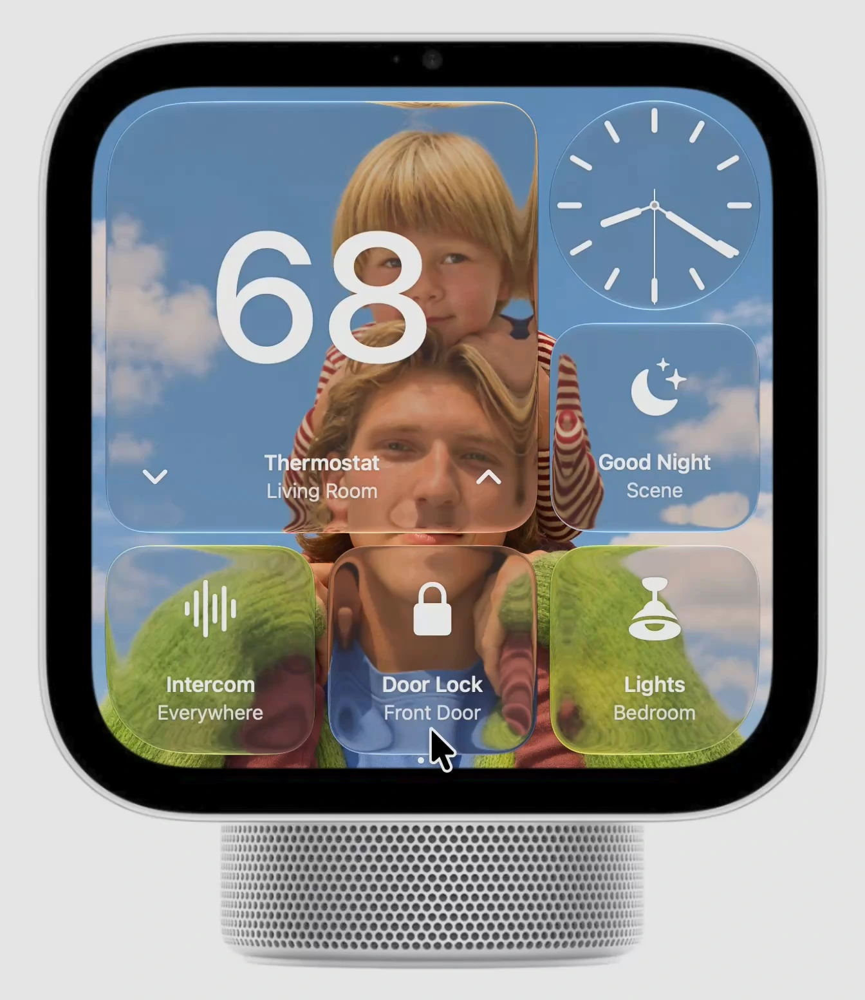

# Apple HomeView Simulator

An independent macOS simulator for prototyping smart-home experiences on Apple HomeView, a compact home display. The simulator runs in SwiftUI and uses simulated device state.

## Why I'm building it

[Xcode offers simulators](https://developer.apple.com/documentation/xcode/building-and-running-an-app) for iPhone, iPad, Apple Watch, Apple TV, and Apple Vision Pro. HomeView doesn’t have a dedicated Xcode simulator. I’m building a place to try HomeView interactions with the same familiar edit, run, and test loop.

## For developers and designers

Open the Swift package in Xcode, edit a SwiftUI view, and run it on **My Mac** to try it inside the HomeView display. Use the dashboard to test layout, readable labels, and tap targets at device scale.

## For people using HomeView

See your actual room and tap a light in the photo to turn it on or off. The photo updates to show how the room looks. It’s recognition over recall: the familiar layout helps you spot the right light without memorizing device names or button locations.

## Demo

[Watch the MP4](Demo/homeview-demo.mp4) · [Download the HDR10 recording](Demo/homeview-demo-hdr.mp4)

## What works today

- SwiftUI dashboard with a clock, simulated thermostat, door lock, intercom, and Good Night scene.
- Tap a room tile to switch all its lights. Hold for one second to open the room.
- Tap a fixture in the room photo or use the group controls to switch several lights together.
- Swipe left for Bedroom 2, Bathroom 1, Kitchen, and Living Room.

## Proposed

- Import a room photo, suggest fixture locations, and generate lighting previews for review.
- Turn LiDAR scans into floor-by-floor home maps with controls at each fixture’s location.
- Package the simulator components as a reusable SDK for custom rooms, devices, and scenes.

## Run locally

Open `Package.swift` in Xcode, select **HomeViewPreview** and **My Mac**, and press **⌘R**. Requires macOS 15 or later and a Swift 6 toolchain.
